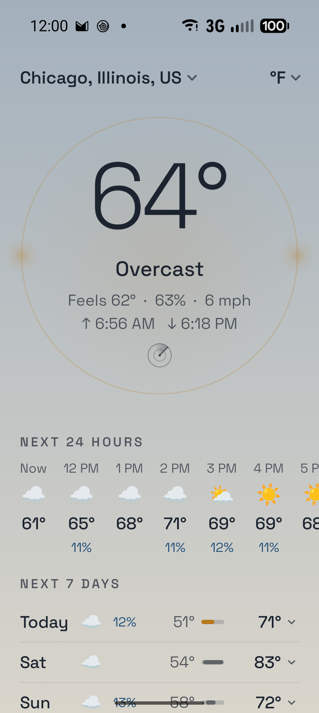

# Weather Balloon



A privacy-first, simplicity-first weather app. One screen: current conditions,
the next 24 hours, the next 7 days.

Named for the [weather balloon](https://en.wikipedia.org/wiki/Weather_balloon)
— the humble instrument that gathers a forecast's raw truth and reports back,
nothing more. On the home screen the current temperature wears a sun halo,
flanked by two bright companion spots.

## Privacy

- Weather and place search come from [Open-Meteo](https://open-meteo.com)
  (keyless, no account, no tracking).
- The radar card (US only, opened from the glyph under the halo) is NOAA
  NEXRAD imagery from the [Iowa Environmental Mesonet](https://mesonet.agron.iastate.edu),
  fetched only while the card is open. Tile requests carry no coordinates,
  just which ~240 km map squares are in view. The base map under it is built
  into the app from public-domain Census and Natural Earth data
  (`tools/basemap/`) and makes no requests at all.
- Only two permissions: `INTERNET` and `ACCESS_COARSE_LOCATION`. Location is
  optional — pin a place by search and revoke it entirely.
- Coordinates are rounded to ~1 km before any request leaves the device.
- The town name in the header comes from the device's geocoder service where
  one exists (on stock Android that's a Play Services network lookup, sent the
  rounded coordinates only). Degoogled devices without a geocoder just show
  "My location".
- No Play Services, no analytics, no third-party SDKs. Networking is plain
  `HttpURLConnection`.
- The last good forecast is cached locally so the app works offline.

## Install

- **F-Droid**: coming soon.
- **GitHub**: download the APK from the
  [latest release](https://github.com/mesmerverse/weather-balloon/releases/latest).

Signing certificate SHA-256:
`3d:49:ad:0c:9c:39:b0:01:e7:64:6f:d6:64:c4:e7:7e:bd:8f:24:1f:60:7e:bf:89:47:90:4e:fe:e3:2d:16:0f`

## Build

```sh
./gradlew assembleDebug
adb install --user 0 -r app/build/outputs/apk/debug/app-debug.apk
```

Toolchain: AGP 9.2.1, Kotlin 2.3.20, Jetpack Compose (BOM 2026.03),
minSdk 34 / targetSdk 36. F-Droid-friendly (`dependenciesInfo` disabled).

Release signing reads `signing.properties` at the repo root (gitignored, never
committed) or the same names from environment variables; without them the
release build is unsigned.

```properties
ANDROID_APK_KEYSTORE_PATH=/path/to/release.keystore
ANDROID_APK_KEYSTORE_PASSWORD=…
ANDROID_APK_KEY_ALIAS=…
ANDROID_APK_KEY_PASSWORD=…
```

## License

Weather Balloon is free software: you can redistribute it and/or modify it
under the terms of the [GNU General Public License v3.0](LICENSE). Space
Grotesk is under the SIL Open Font License (`licenses/`).
